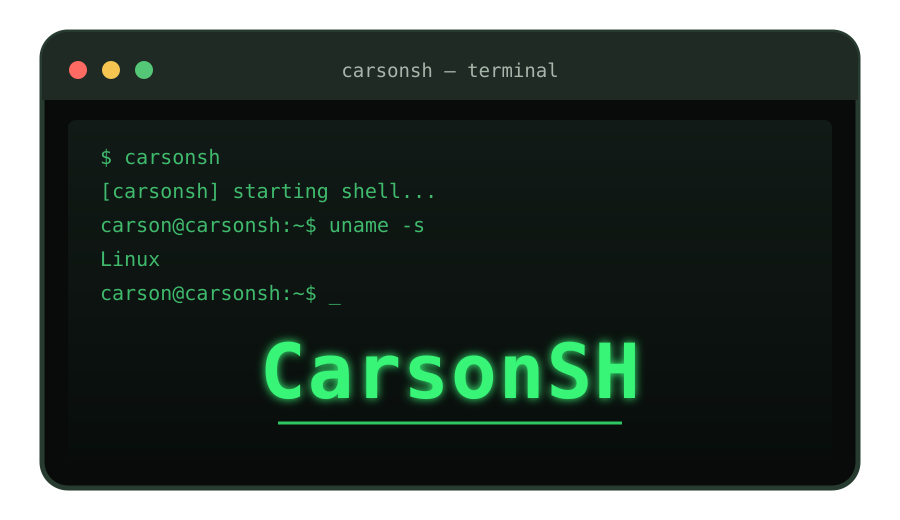

# CarsonSH 🐚

<p align="center">
  
</p>


CarsonSH is a small, experimental Unix shell written in C.

The goal is to build a real shell from the ground up instead of wrapping an existing shell. CarsonSH is intended to run on Linux systems including Debian/Ubuntu-based distributions and Arch-based distributions such as EndeavourOS.

## Current status

**Early development — v0.1**

- Interactive prompt
- Kali-style green prompt and banner
- Git branch shown in the prompt when inside a Git repository
- Built-in `cd`
- Built-in `pwd`
- Built-in `cpufetch`, `gpufetch`, and `displayfetch` system information commands
- Built-in `echo`
- Built-in `alias` and `unalias`
- Built-in `history` with persistent history storage
- Built-in `reload` for reloading configuration
- Built-in `help`
- Built-in `theme` and `plugin` framework commands
- External command execution through `PATH`
- Basic command arguments
- User configuration at `~/.config/carsonsh/config`
- History stored at `~/.carsonsh_history`
- Consecutive duplicate history entries are ignored

## System fetch commands

CarsonSH includes three built-in system information commands:

```text
cpufetch       Show CPU model, logical CPU count, and a short current-usage sample
gpufetch       Show detected GPU and available utilization/memory information
displayfetch   Show connected display modes and refresh rates when available
```

On Linux, `cpufetch` reads the CPU model from `/proc/cpuinfo` and samples total CPU usage from `/proc/stat`. `gpufetch` uses `nvidia-smi` for NVIDIA utilization and memory details when available, then falls back to `lspci` for GPU identification. `displayfetch` checks `xrandr`, then `wlr-randr`.

On Windows, the GPU and display commands query Windows' `Win32_VideoController` information through PowerShell. GPU utilization is not currently reported by the Windows implementation. Unsupported or unavailable system interfaces are reported instead of guessed.

## Example scripts

Beginner-friendly example scripts are available in [`others/examples/`](others/examples/):

- [`example.sh`](others/examples/example.sh) — a POSIX shell script showing commands such as `pwd`, `echo`, `date`, `uname`, and `ls`.
- [`example.ps1`](others/examples/example.ps1) — a PowerShell script showing `Get-Location`, `Write-Output`, `Get-Date`, `Get-CimInstance`, and `Get-ChildItem`.
- [`COMMAND-CHEATSHEET.md`](others/examples/COMMAND-CHEATSHEET.md) — a beginner-friendly reference for CarsonSH built-ins, aliases, history, themes, plugins, and external commands.

Run the examples from the repository's root directory while CarsonSH is open:

**Linux / Unix-like systems:**

```sh
sh others/examples/example.sh
```

**Windows (PowerShell):**

```text
powershell.exe -NoProfile -File others/examples/example.ps1
```

These are example scripts for the external interpreters, not native CarsonSH scripts. CarsonSH can launch external programs, but native `.sh` / `.ps1` scripting, variables, pipes, and redirection are not implemented yet. You can still try CarsonSH's own built-ins directly at its prompt:

```text
help
pwd
echo Hello from CarsonSH
history
cpufetch
gpufetch
displayfetch
```

The `.gitignore` in `others/examples/` ignores generated logs, temporary output files, and the local `output/` directory for this examples folder only; it does not add ignore rules to `others/` itself.

## Oh-My-Shell-inspired customization

CarsonSH includes a native C implementation inspired by documented ideas from KasRoudra's Oh-My-Shell project: aliases, a customized prompt, a banner, and terminal customization.

See [CREDITS.md](CREDITS.md) for attribution and licensing information.

CarsonSH intentionally does not execute or copy the original Oh-My-Shell installer's obfuscated payload. Features are implemented directly for CarsonSH instead.

## caarlos0/dotfiles.zsh-inspired shell behavior

CarsonSH also takes inspiration from shell configuration practices documented in [caarlos0/dotfiles.zsh](https://github.com/caarlos0/dotfiles.zsh), especially persistent history, ignoring consecutive duplicate history entries, and a convenient configuration reload command.

These features are independently implemented in C; CarsonSH does not copy the upstream Zsh configuration files. See [CREDITS.md](CREDITS.md).

### Configuration

Copy the example configuration:

```bash
mkdir -p ~/.config/carsonsh
cp config/carsonsh.conf.example ~/.config/carsonsh/config
```

Then start CarsonSH. Aliases from the file are loaded automatically.

Examples:

```text
alias ll=eza -la
alias la=eza -a
alias cls=clear
alias reload=reload
welcome on
```

CarsonSH prints `welcome to carsonsh` at startup by default, regardless of the selected theme. To hide the startup line, add `welcome off` to this config. Use `welcome on` to show it again. Invalid values produce a config warning and do not stop startup or prevent later config lines from loading.

You can also create an alias during a session:

```text
alias ll=eza -la
unalias ll
```

### History

CarsonSH keeps up to 1000 history entries in `~/.carsonsh_history`.

```text
history
history 50
```

The default `history` output shows the 20 most recent commands. Consecutive duplicate commands are not added again.

### Reloading configuration

After editing `~/.config/carsonsh/config`, reload aliases without restarting CarsonSH:

```text
reload
```

## Building

On Debian/Ubuntu/Linux Lite:

```bash
sudo apt install build-essential
```

On Arch/EndeavourOS:

```bash
sudo pacman -S base-devel
```

Then:

```bash
./build.sh
./build/carsonsh
```

> **Note:** Depending on how you obtained the repository or which filesystem you are using, the shell scripts may not have their executable bit set. If you get a **Permission denied** error, run:
>
> ```bash
> chmod +x build.sh install.sh uninstall.sh
> ```

Install locally:

```bash
./install.sh
```

This installs to `~/.local/bin/carsonsh` by default.


## Terminal font fallback and prompt wrapping

CarsonSH cannot change or inspect the font selected by your terminal emulator. It can, however, avoid many broken-glyph situations:

- The prompt uses an ASCII-safe variant when the active character locale is not UTF-8 or the terminal reports `TERM=dumb`.
- Set `CARSONSH_ASCII=1` to force the ASCII prompt, or `CARSONSH_ASCII=0` to allow Unicode when your locale supports it.
- Long working-directory paths are compacted using the terminal's `COLUMNS` setting (80 columns by default) to reduce awkward prompt wrapping.

For best Unicode rendering, choose a font with broad Unicode coverage in your terminal emulator. CarsonSH cannot reliably detect missing glyphs in a particular font or change that font automatically.

## Windows builds

Every GitHub Actions release now also publishes `carsonsh-windows-x64.zip` alongside the Debian package. The Windows archive includes the MSYS2 runtime DLL dependencies needed by this experimental build. Extract the ZIP and run `carsonsh.exe` from Windows Terminal or Command Prompt.

## Debian package

GitHub Actions automatically builds a Debian package on pushes to `main`. Releases include CarsonSH, the Ubuntu Condensed font support, and the bundled CarsonSH Framework components.

Install a release package with:

```bash
sudo apt install ./carsonsh_0.1.X_amd64.deb
```

The package installs the framework's bundled themes and plugins under:

```text
/usr/share/carsonsh/framework/
```

It also provides the `carsonsh-framework` command.

### Framework installer commands

List the themes and plugins bundled with the installed Debian package:

```bash
carsonsh-framework list themes
carsonsh-framework list plugins
```

Install an individual bundled theme or plugin into your user configuration:

```bash
carsonsh-framework install theme carson-green
carsonsh-framework install theme minimal

carsonsh-framework install plugin git
carsonsh-framework install plugin linux
carsonsh-framework install plugin shortcuts
```

Update your user framework components from the version bundled with the installed package:

```bash
carsonsh-framework update
carsonsh-framework select-theme <theme-name>

For example:

```bash
carsonsh-framework themes
carsonsh-framework select-theme pure
```

The additional themes are native CarsonSH prompt implementations inspired by well-known shell prompt styles; CarsonSH does not copy their upstream shell code.
```

Then reload CarsonSH:

```text
reload
```

The framework installer is intentionally limited to bundled, inspectable `.conf` files. It does not execute arbitrary downloaded shell code.

## CarsonSH Framework

CarsonSH includes a lightweight theme and plugin framework, inspired by the organization of frameworks such as Oh-My-Fish while being implemented specifically for CarsonSH.

The source framework lives in:

```text
framework/
├── install.sh
├── themes/
│   ├── carson-green.conf
│   ├── minimal.conf
│   ├── robbyrussell.conf
│   ├── agnoster.conf
│   ├── pure.conf
│   ├── spaceship.conf
│   └── powerlevel10k.conf
└── plugins/
    ├── git.conf
    ├── linux.conf
    └── shortcuts.conf
```

Inside CarsonSH:

```text
theme
theme minimal
plugin
plugin git
```

Framework plugins are plain `.conf` files, making them easy to create, inspect, and share without requiring arbitrary code execution.

## Roadmap

- [x] Interactive shell loop
- [x] Basic built-ins
- [x] External commands
- [x] Aliases
- [x] Custom configuration
- [x] Git-aware prompt
- [x] Persistent command history
- [x] CarsonSH Framework
- [x] Debian package
- [ ] Pipes
- [ ] Redirection
- [ ] Better line editing
- [ ] Interactive auto-suggestion
- [ ] Interactive syntax highlighting
- [ ] Shell variables
- [ ] Functions
- [ ] Job control
- [ ] Shell scripting

## Why?

Because making a shell sounds fun. 🐧

CarsonSH is a learning project and will probably get weird along the way.

## License

MIT


### CarsonSH banner

The startup ASCII logo is now opt-in. CarsonSH starts without the banner by default. Set `CARSONSH_BANNER=1` before launching CarsonSH if you want the logo and startup text.
